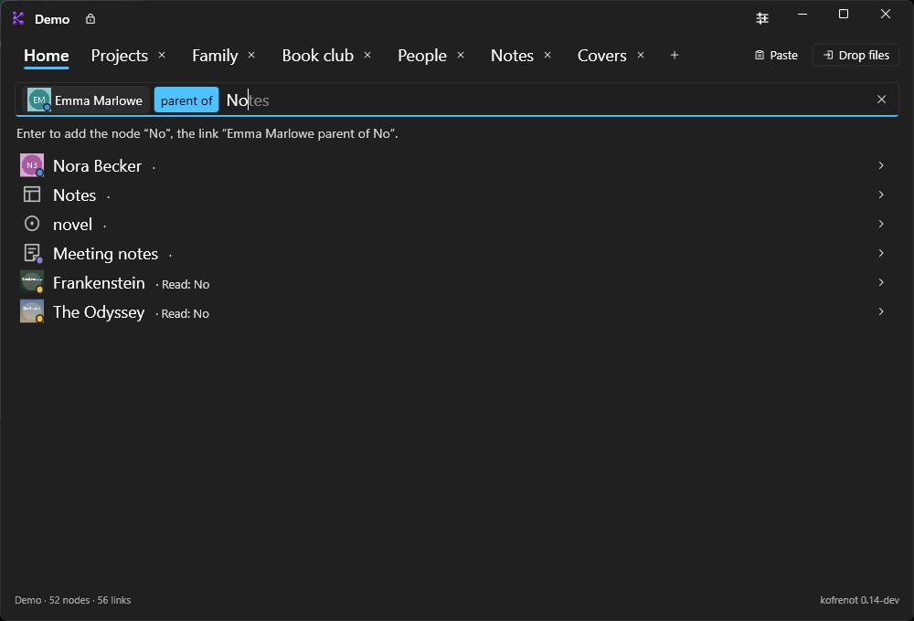
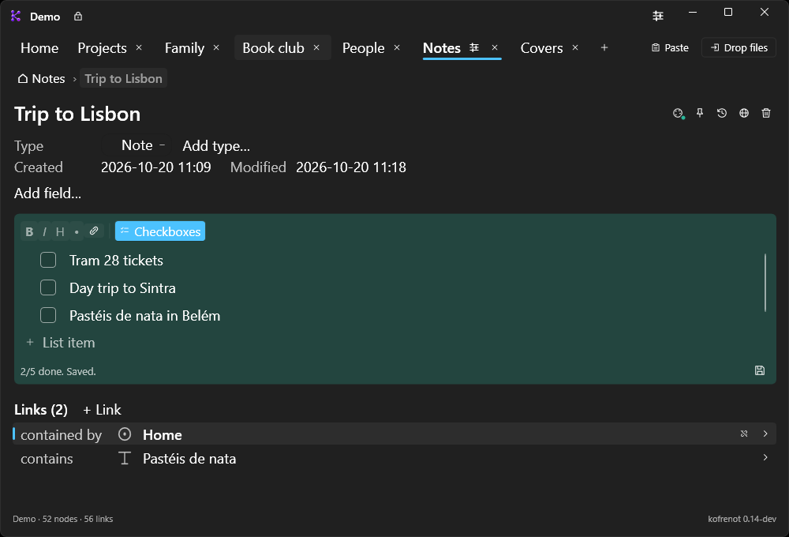
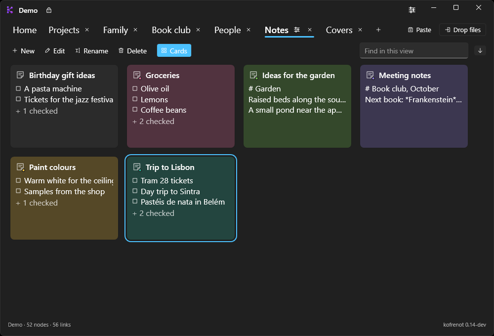
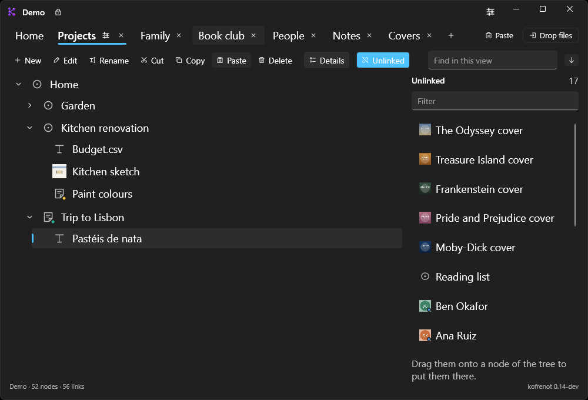
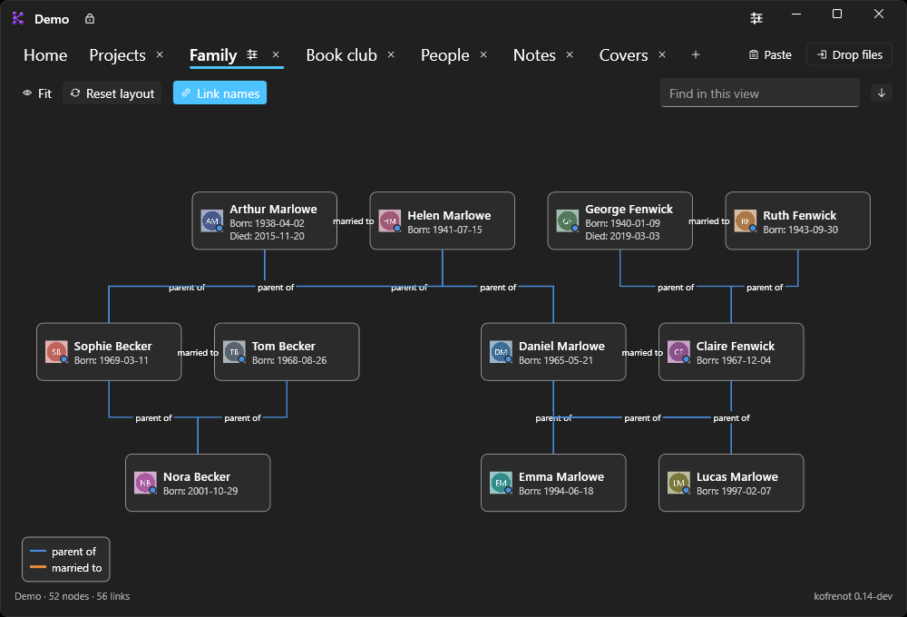
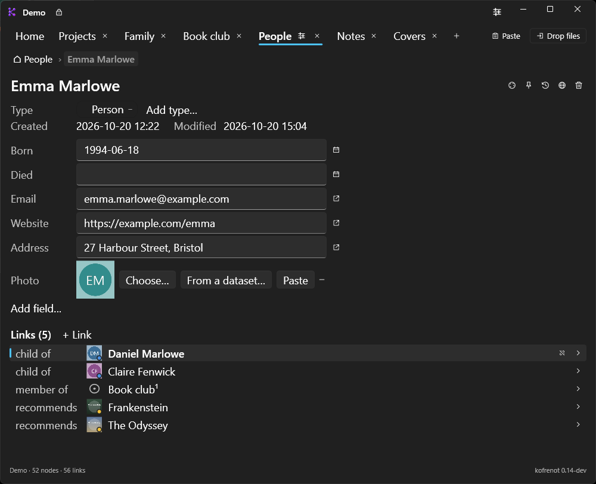
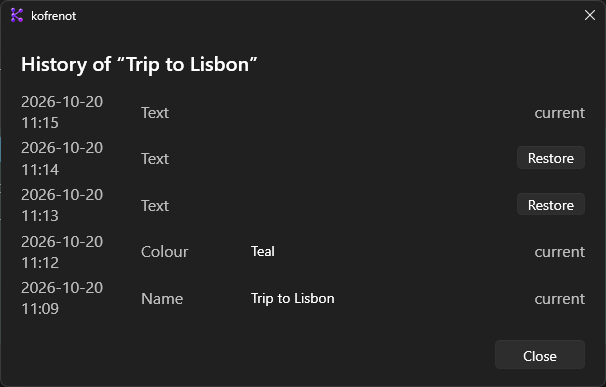

# kofrenot

A private knowledge system for Windows, and Android: notes, files and the links between them, encrypted, usable offline, and synced and shared through your own server.



> **kofrenot + Kofre server.** kofrenot is the app; [**kofreserver**](https://github.com/dyze/kofreserver) is its companion server, to run yourself or to get an account on. It syncs your vaults across your devices and shares them with others. It only stores encrypted files: it cannot read them.
>
> ```
> kofrenot (laptop) ─┐                              ┌─ kofrenot (desktop)
>                    ├─► Kofre server (yours) ◄──────┤
> kofrenot (work PC) ┘   encrypted files only        └─ kofrenot (a friend: shared vault)
> ```

**Contents**: [Features](#features) · [Install](#install) · [First five minutes](#first-five-minutes) · [Vaults](#vaults) · [On Android](#on-android) · [Using kofrenot](#using-kofrenot) · [Keyboard shortcuts](#keyboard-shortcuts) · [Settings](#settings) · [Your data](#your-data) · [Development](#development)

## Features

- **One box to find and add**: type `Dune`, or `Dune relates to Frank Herbert`, and the nodes and the link are added. Your own link types too, and **qualifiers** that give a link its context: `Dune written by Frank Herbert, Date 1965`.
- **Notes** in Markdown, with **task lists** and **colours**, as in Google Keep.
- **Datasets**: files of any kind and size, with thumbnails and a viewer for images and texts.
- **Your node types**: a *Person* with a birth date and a website, a *Book* with its genre; a node can have several, and fields of its own. Values are searched offline.
- **Views**: trees and lists over your nodes, in tabs, shown as rows or as **cards**; **graphs** for a family tree or the relations around a node (Windows).
- **Encrypted**: everything in a vault, names included, opened by your pass phrase or your recovery key.
- **Offline first**: browse, search and add without a network.
- **Sync and share** through a Kofre server, as a reader or a writer.
- **Versioned**: nothing is overwritten; a node's **history** restores any version, and edits made on two devices are shown, never lost.
- **Quick capture**: drop files, or paste what you copied (files, a screenshot), on Windows; share from any app on Android.
- **Import from JSON**: a list of books or contacts becomes nodes of your types, updated when imported again, after a preview (Windows).

### Windows and Android
Both apps share the same vaults and the same core; each shows its own set of features. ✔ supported, — not yet ([ROADMAP](ROADMAP.md)), *never* not planned ([why](docs/ANDROID-CONCEPT.md#not-supported)); a note says how it differs.

| Feature | Windows | Android |
| --- | --- | --- |
| **Vaults** | | |
| Server vaults: add from the server, open, remove from the device | ✔ | ✔ |
| Switch to another vault | ✔ the title bar, **Ctrl+1** to **Ctrl+9**, a vault's hotkey | ✔ **☰** > *Switch to …* each other vault on the phone |
| Server vaults not added yet shown by name | ✔ | ✔ with the account's identity remembered on the phone |
| Lock the open vault (padlock) | ✔ | — |
| Privacy screen: the vault covered while hidden | ✔ | out of screenshots and recent apps, unless turned off in Settings > General |
| Hide or lock the vault when the computer locks or sleeps; cover or lock it after a while without input | ✔ | — |
| Server vaults: create, move from a folder, delete | ✔ | — |
| Folder vaults | ✔ | *never* |
| Account: sign up, sign in | ✔ | sign in only |
| Account's pass phrase, recovery key | ✔ | used, not set |
| Sync status, sync now | ✔ | ✔ while the app is shown |
| A vault changed by a newer kofrenot: read only, when it allows it | ✔ **Read only** in the title bar | ✔ a banner |
| **Browse** | | |
| Search names, pinned and recent nodes | ✔ | ✔ |
| Search field values | ✔ | ✔ |
| Search links by a qualifier (`written by, Date 1965`, `, Source isfdb`); ranges of dates and numbers (`Born 1900..1950`) | ✔ | ✔ |
| Queries: by type (`?person:`), linked to a node (`?contained by Kitchen`), through links with qualifiers (`?read by Alice, Date 2026`), by time (`?changed: this week`), with proposals; `?` alone lists how to start one | ✔ | ✔ |
| A link's first qualifier shown after its other node | ✔ in its row; beside its name in a graph | ✔ in its row |
| Recent: opened here or changed on any device (last 7 days) | ✔ empty input box, as many as the window fits, in columns when wide | ✔ home, as many as the screen fits, in columns when wide (turned, a tablet) |
| Node details, links | ✔ the Link box with labels and proposals, as the input box | ✔ **+ Link** with labels and proposals, as the Link box |
| Node types and fields shown | ✔ | ✔ (an image's thumbnail, a tap shows it whole, **Open**) |
| Views: trees and lists, as tabs | ✔ rows, cards (as tall as their content, pinned first, arranged by dragging), details; tabs reordered by dragging, **▾** lists those that do not fit | ✔ rows, cards (**▦** on a list's bar: in columns, pinned first, as arranged on Windows); **▾** lists those that do not fit, then the views to open; **⋮** of a view tab moves it left or right, closes it; a swipe across the list goes to the next or previous tab, the list following the finger |
| Views: what a query finds, with columns of linked nodes (*written by*), fields and qualifiers | ✔ **Save as a view…** under a query, a table | ✔ a table, sorted by a tap on a header |
| Views: graphs (family tree, network), nodes moved by hand | ✔ several at once; colours, link names, minimap, search; links and nodes added, files pasted, links removed | — (says it is shown on Windows) |
| Unlinked nodes (no link leads to them), put into a tree | ✔ **Unlinked** beside a tree, dragged onto a node | ✔ **⋮** of a tree tab > *Unlinked nodes…*, one at a time |
| Pin (synced: listed while the input box is empty) | ✔ | ✔ **⋮** on the node's page |
| Search the node's name on the web (only then does it leave the device) | ✔ the globe in the details header, the engine of Settings > General (Google, DuckDuckGo or Bing) in the default browser | ✔ the globe in the top bar, the phone's own search app (else the browser) |
| Keep offline (this device only: content downloaded ahead) | ✔ server vaults | ✔ |
| **Change** | | |
| Add nodes and links (input box, creation screen) | ✔ | ✔ the search box, then a creation screen, or **＋** > *Add a node…* (a view on Windows; a dataset with **＋**) |
| Labels and proposals while typing (a name or link type becomes a label; the rest of a name proposed after it) | ✔ up to 5 proposals listed, **Up/Down** select one, **Tab** or **Enter** accepts, **Backspace** unlabels, **Esc** clears | ✔ up to 5 proposals listed under the box, **Enter** accepts the one in bold, a tap accepts any; a tap on the last label or **Backspace** unlabels, **×** in the box clears its labels and text |
| Rename, colour, pin; move and copy in a tree | ✔ | ✔ rename, colour, pin (**⋮**); not in a tree |
| Delete a node, remove a link (asked first, naming what goes) | ✔ a node from its details (**Ctrl+Del**), a list (**Del**) or the search (right-click), a subtree in a tree (**Del**); a link with its broken-link button or right-click | ✔ a node (**⋮**), a link (long press) |
| Types: add to a node, take out | ✔ | ✔ **⋮** (a view is made on Windows) |
| Your node types: create, change, remove, copy from another vault (Settings > Node types) | ✔ | listed with their fields, read only (Settings > Node types) |
| Fields: fill, add your own, merge, resolve a conflict | ✔ | ✔ fill (a tap), add your own (text, number, date, web address, email, postal address, phone number, checkbox), resolve a conflict, an image set (chosen, a photo taken, from a dataset, or shared by another app) or removed; a merge on Windows |
| Fields: open a web address, write to an email, show a postal address on a map, call a phone number | ✔ **↗** | ✔ an icon right of the value: open, mail, map, phone |
| Qualifiers typed after a link (`, Date 1965`), the link updated by its sentence again | ✔ the input box and the Link box, labels and proposals; the creation screen to fill them | ✔ the search box and **+ Link**, labels and proposals |
| Qualifiers: fill, add your own, take out, resolve a conflict, history | ✔ the chevron at the right of a link's row; a click on a line of a graph | ✔ a tap on a link with qualifiers (its sheet), a long press to add one of its own |
| Several links of a type between two nodes (*married to Bob · 1995*, *· 2015*) | ✔ the input box asks which one, or **+ a new link** | ✔ shown, the first one updated |
| A link type's qualifiers, built-in link types included (Settings > Link types) | ✔ | listed with their reverse and aliases, read only (Settings > Link types) |
| Link types, their qualifiers and aliases: copy from another vault (Settings > Link types) | ✔ | — |
| History: a node's versions (text, file, view, names, colours, field values) | ✔ listed, restored | ✔ listed, restored |
| Notes: edit | ✔ editor with a Markdown toolbar and a task list editor, checked items collapsed | ✔ Markdown text (no toolbar), task list editor, checked items collapsed (no reordering) |
| Notes: resolve a conflict | ✔ keep one, or merge by hand | ✔ keep one, or merge by hand |
| Datasets: add files | ✔ creation screen, drop zone, drop on a tree, **Paste** (files or an image copied); folders as a hierarchy | ✔ **＋**, with a preview; a photo or video taken |
| Import destination: under a node of a tree, the last one kept per vault, or no parent | ✔ drop zone | ✔ **＋** and the share sheet (files and text) |
| Add what another app shares (files as datasets, text as a note, an image as an image field's) | — (drop or paste files instead; **Paste** by an image field) | ✔ the share sheet, with a preview; an image to the node shown first |
| Datasets: new version of a file, resolve a conflict | ✔ **Import…**, a drop, **Paste** | ✔ **Import…** (a conflict resolved by importing; keeping one of its versions on Windows) |
| Datasets: view images and texts | ✔ | images, on the whole screen: pinch or double tap to zoom (texts with another app) |
| Datasets: open in another app, export, share | ✔ **Open**, **Export…**, drag out (several at once, with their tree as folders) | ✔ **Open**, **Export…**, **Share…** (Android's share sheet) |
| Views: create, edit (a tree sorted by a qualifier of its links, a query and its columns) | ✔ | — |
| Import a JSON file's records as nodes, with a mapping kept in the vault (**Imports**) | ✔ | — (a mapping shown as a node) |
| Import nodes of another vault found by a query (**Imports** > **From a vault…**) | ✔ | — |
| **Share** | | |
| Members, roles, share, leave | ✔ | ✔ share, change a role, leave (Settings > Vault > **Members…**); a member removed on Windows |
| **App** | | |
| Hotkeys, tray, start with Windows, update check | ✔ | *never* (Windows desktop) / — update check |
| Settings | ✔ every tab | Vault, Server, Node types, Link types, Appearance, Logging and About: the vaults on the phone, members, forget the pass phrase, sign out, the types read only, theme, logging |
| Theme: light, dark, or as the system (Settings > Appearance) | ✔ | ✔ |
| Exchanges with the server, per day (Settings > Logging) | ✔ | ✔ |

How to use each: [Using kofrenot](#using-kofrenot) (Windows), [On Android](#on-android).

| A note with its task list | Cards | A tree |
| --- | --- | --- |
|  |  |  |
| **A family tree** | **A person, with fields** | **History** |
|  |  |  |

## Install

Download `kofrenot-windows-setup-<version>.exe` from the [releases](https://github.com/dyze/kofrenot/releases) and run it: it installs for your user only, no administrator rights, and needs no .NET runtime. Run a newer setup to upgrade; uninstall from *Settings > Apps* (your data stays).

**Portable**: unzip `kofrenot-windows-portable-<version>.zip` anywhere (a USB stick) and run `kofrenot\kofrenot.exe`: its data stays in the `data` folder beside it.

kofrenot runs in the notification area. **Ctrl+Alt+K** shows it from any program; closing the window hides it.

**Start with Windows** (on by default in the setup, then in Settings > General): when you sign in, kofrenot starts in the notification area, and opens your vault (asking for its pass phrase if not remembered) only when you first show it. The box is ticked only when Windows starts *this* copy; if it starts another one (the installed copy, while you run a build), Settings shows its path, and ticking the box switches to this copy.

## First five minutes

1. **Add a vault**: Settings > Vault, *New vault on the server* (sign in first, Settings > Server) or an empty folder. Keep the recovery key it shows ([Vaults](#vaults)).
2. **Type** `Dune relates to Frank Herbert` in the box at the top, then **Enter**: two nodes and their link ([Input box](#input-box)).
3. **Write a note**: type `Groceries`, choose *Note* on the creation screen, tick **Checkboxes** for a task list ([Notes](#notes)).
4. **Drop files** on *Drop files* beside the tabs, or **Paste** what you copied: each becomes a dataset ([Datasets](#datasets)).
5. **Open a view**: **+** in the tab bar, a tree from *Home*, a list of your notes as cards, or a graph ([Views](#views)).

## Vaults

A vault holds your nodes, notes and files, encrypted. There are two kinds:

| | **Server vault** (recommended) | Folder vault |
| --- | --- | --- |
| Where | On a [Kofre server](https://github.com/dyze/kofreserver), and on each of your devices | A folder you choose |
| Sync | Built in: every 30 seconds, and soon after a change | Your own sync tool (OneDrive, Syncthing...), or none |
| Sharing | With other accounts on the server, as readers or writers | No |
| Content | Downloaded when first needed: a device keeps only what it uses | All of it, on every device |
| Backup | On the server, by its admin; your devices keep a copy | Yours to make |
| Pass phrase | One for all your server vaults, the account's | One per vault |

- **Add one** in Settings > Vault: *New vault on the server* (sign in first, in Settings > Server), *Vault from the server…*, or a folder (an empty one becomes a new vault). A folder vault can be moved to the server later (*Move to server…*). *Vault from the server…* lists a vault by its name once it was opened on a device of yours (its name is then kept in your account, encrypted so that only your account's pass phrase reads it: typed if not remembered here, Cancel shows them by id); before, by its id.
- **Recovery key**: shown once when the vault (or the account's pass phrase) is created. Keep it with the pass phrase: **if both are lost, the vault cannot be read**.
- **Several vaults**: one is open at a time, switched in the title bar (or **Ctrl+1** to **Ctrl+9**); each can have its own hotkey. The **padlock** (**Ctrl+L**) locks the open one until its pass phrase is typed again.
- **Privacy screen** (on by default, Settings > General): when the window is hidden or minimized, the open vault is covered, also in the taskbar preview; shown again, it opens on a plain screen until you click **Show** (or press Enter), so nothing shows by mistake while sharing your screen. Unlike the padlock, no pass phrase is asked.
- **Hidden, covered or locked on its own** (Settings > General): when Windows locks (Win+L, the screen saver) or goes to sleep, the open vault is **hidden** (the default: covered and the window hidden, it opens again on the cover, no pass phrase asked), **locked** (its pass phrase asked again, even when remembered), or left as it is. After a while without keyboard or mouse input, in any program, the vault shown is **covered** (5 minutes by default), and can be **locked** too (never by default). A lock closes the dialogs open, as Cancel (the changes to a node type in Settings are dropped); while a note is not saved or a file imported, the vault stays covered and locks once it can.
- **Share** a server vault: Settings > Vault > *Members* > *Share...*, with the other person's email, once you both read the same key **fingerprint** (by phone or in person). Removing a member changes the vault's key.
- **Sync status** is in the title bar: a green dot when synced, amber offline, red when you must sign in. A click syncs now.
- **A vault changed by a newer kofrenot** opens **read only** when that version allows it: you see and search it, without what this version does not know, and change nothing; *Read only* in the title bar leads to the latest kofrenot. Otherwise it stays closed until you update.

## On Android

kofrenot for Android **reads** your server vaults, also offline, and **changes their nodes**: notes, files, names, colours, pins, deletes. What defines a vault (your node and link types, its name, its keys) is changed in kofrenot on Windows ([why](docs/ANDROID-CONCEPT.md#what-the-phone-changes)).

- **Install**: download `kofrenot-android-<version>.apk` from the [releases](https://github.com/dyze/kofrenot/releases) and open it (Android 8.0 or later; allow installing from your browser or file app when asked).
- **Sign in** with your server account, then **Add from the server**: your vaults and those shared with you, which show your role (reader or writer) in the list; a vault shared with you to read says so in a banner. The account's pass phrase opens them; tick *Remember it on this phone* to keep it in the phone's Keystore. **☰** on the home shows the open vault and *Sync now*, then *Switch to …* for each other vault on the phone, with its sync dot (its pass phrase asked when not remembered); **Settings > Vault** (or **☰** > *Vaults*) lists the vaults on the phone, the open one in bold: a tap opens one, **✕** removes it from the phone (asked first), *Add from the server* adds another.
- **Read**: search names, pinned nodes, recent nodes (opened on the phone or changed on any device; as many as the screen fits, in two columns when the phone is turned, three on a tablet, as on Windows), each row with its icon, or its thumbnail for an image (a dataset's, or its image field's), as on Windows; a node's details and links (a link opens a screen of its own; Back or **←** goes back through them, the trail at the top shows them as chips, a tap on one going back to it, or home; a link to a node already in the trail is greyed, as on Windows), notes with their task lists, views as tabs (within the screen's width, **▾** always at their right lists them all and opens another; a view tab's bar shows its rows, **▦** on a list's to show its nodes as cards (in columns, as tall as their content: a note's lines, or its unchecked items and how many are checked; a file's kind and size, or its thumbnail; in the node's colour, pinned first, then as arranged on Windows; kept per view on the phone), and **⋮** > *Move left*, *Move right* (the order kept on the phone, Home staying first) and *Close view*), a node's **History** (**⋮** > *History…*: its versions on a screen of their own; **Restore** makes one the current one again, after a confirmation). A dataset shows its file's name and size, and an image its thumbnail; a tap on an image's thumbnail (a dataset's or an image field's) shows it on the whole screen, downloaded first when not here: pinch or double tap to zoom, a finger to move it, **⋮** to open or share it. A file's actions: **Import…** saves a file picked on the phone as its new version, **Open** hands it to the app you pick, **Export…** saves it where you choose, **Share…** sends it through Android's share sheet (a message, a mail, a cloud). A copy opened with another app is deleted from kofrenot at its next start.
- **Add files**: **＋** (at the bottom right of the home) picks one or several files on the phone; a sheet lists them (their number and total size, the names already taken, a file updating its dataset), then where they go: **Add into** the node last chosen in this vault (on this phone), **Add elsewhere…** (a tree view, then down its tree a node at a time, Back going up; its own preview follows), or **Add with no parent**. Each becomes a dataset named after its file; the choice is kept for the next time. One file added opens; several show among the recent nodes.
- **Unlinked nodes**: **⋮** of a tree view tab > *Unlinked nodes…* lists the nodes no link leads to, the newest first (at most 100; a filter finds the others); a tap opens one, or moves it into the tree, under the node you reach.
- **Take a photo** or **Record a video** (under **＋**): the phone's camera app takes it, then the same preview names it after when it was taken (*Photo 2026-10-28 20.30*) and **Add** makes it a dataset. kofrenot asks it to write into kofrenot's own files, not the gallery, and deletes its copy once added or cancelled; some camera apps still keep one of their own in the gallery.
- **Share to kofrenot** from another app (its *Share* button): files become datasets, text or a link becomes a new note named after its first line. **One image** (a browser's *Share image*) also offers to be **the image of a node's image field**: of the node shown, first when it has one, or of another found by its name (only nodes with an image field are listed); its page then shows it. A preview names the open vault, lists what will be added and where it goes, as for **＋**: nothing is added before you choose. When no vault is open yet, it waits until you open one.
- **Add nodes and links**: type in the search box as in the input box on Windows: `Dune`, `Dune relates to Frank Herbert`, `Kitchen contains Knives`. The line under it says what it adds; a tap shows the creation screen: the link's type, each new node's type (a note with its text), then **Add** adds them and goes back, as on Windows: the search box cleared, their nodes first among the recent ones. A view is made on Windows, a dataset with **＋**. **＋** > *Add a node…* opens the creation screen with the name to type, as a view's *New* on Windows: in a list, of its type; in a tree, under its root. As on Windows, a node or link type recognized becomes a label, and the rest of a name is proposed in grey right after the text; when there are several, up to 5 are listed under the box, the one in grey in bold: **Enter** accepts it, a tap accepts any, and **Enter** with no proposal shows the creation screen; a tap on the last label (or **Backspace** with no text after it) turns it back into text.
- **Change a node**: a tap on its name renames it, as a click does on Windows; **⋮** on its page (each action with its icon) renames it too, gives it a colour, pins or unpins it, or deletes it with its links (asked first, naming what goes). A long press on a link removes it (asked first, saying when a node is left with no link); the nodes stay. **+ Link** beside *Links* links the node to another, as the Link box on Windows: type after its name (`relates to Frank Herbert`, `written by Frank Herbert, Date 1965`), with labels and proposals, the line under it saying what **Enter** does; **Enter** shows the link's creation screen. A link there typed again with qualifiers is updated; **✕** hides the box. Each change reaches your other devices at the next sync.
- **Fields and types**: a tap on a field fills it: a text typed (empty clears it), a checkbox ticked, an option chosen, a date picked in a calendar, an image chosen with the phone's picker, a photo taken, or an image dataset of the vault (*From a dataset…*, not copied), or removed (asked first). **⋮** adds a field of its own (its name, then its kind as on Windows, then its value), adds a type or takes one out (asked first; the values of its fields stay, as the node's own). A name, colour or value set on two devices before they synced shows each, to keep one.
- **Settings** (**☰** on the home, at the bottom) lists its topics, as Android's own, each with where it stands and on a screen of its own, named as the Windows tabs: **Vault** (the open vault, *Members…*, forget its remembered pass phrase; the vaults on the phone), **Server** (the account, *Sign out*), **Node types** and **Link types** (the open vault's, read only: a node type's fields, a link type's reverse, aliases and qualifiers; changed on Windows), **Appearance** (light, dark, or *Follow Android*, the default), **Logging** (debug details, exchanges with the server) and **About**.
- **Members**: Settings > Vault > **Members…** lists the open vault's members and their roles. Its owner shares it with another account of the server (by its email, after comparing its fingerprint), as a writer or a reader, and a tap on a member makes them a reader or a writer; removing one is done on Windows, as it changes the vault's key. A member leaves a vault shared with them.
- **Edit notes**: a note is always editable, as on Windows, and saved when you leave it (another screen, Back, the app in the background) or by the save icon; its status says *Saved.* or *Not saved*, after how many items are done. A note whose lines are all items shows as its list: a checkbox and a text per item, those not checked first, **Add item** after them, the checked ones collapsed under *n checked* until tapped; **Enter** adds the next item, **✕** (on the item typed in) or **Backspace** in an empty one removes it. **Checkboxes** turns a text into items, **Text** turns them back into lines. Other notes are edited as Markdown text (`# heading`, `- item`). A note edited on two devices before they synced offers each version, dated, to keep, or merge them by hand and save.
- **Offline**: every name and link is on the phone; a note's text once it has been shown, and the content of the nodes you **Keep offline** (the download icon in a node's top bar, in the accent while kept, or **⋮** > *Keep offline*) at once. What you save offline waits on the phone (*· 2 to upload*) and is uploaded at the next sync. The phone syncs when the app opens or comes back, then every 30 seconds while it is shown; the dot on **☰** says how it stands, and **☰** > *Sync now* syncs now.
- **Private**: the app's screens stay out of the recent apps list and of screenshots. To take a screenshot, untick Settings > General > *Keep kofrenot out of screenshots*; it takes effect at once.
- A vault that needs an upgrade, or an account without its pass phrase yet, is opened once in kofrenot on Windows first.

## Using kofrenot

### Input box
Type in the box at the top of the main window; the line under it says what Enter adds.

| You type | Enter adds |
| --- | --- |
| `Dune` | the node *Dune* |
| `Dune relates to Frank Herbert` | a link between them, and the nodes not there yet |
| `Kitchen contains Knives` | a link from *Kitchen* to *Knives*, read *Knives contained by Kitchen* from the other side |
| `Dune is a novel` | a link from *Dune* to *novel* |
| `Dune written by Frank Herbert, Date 1965, Source isfdb.org` | the link with its **qualifiers**; typed again for a link already there, it updates them (*Date: 1965 → 1966*); `, Date` with no value takes one out |
| `written by, Date 1965` · `Frank Herbert wrote, Date 1960..1970` · `, Source isfdb` | nothing: it **finds the links** of that type, of that node, or any, with that value or in that range, each opening the node it leads to |
| `?person:` · `?person: Frank` | nothing: it **lists the nodes of a type**, or those of it whose name matches, by name |
| `?contained by Kitchen` · `?written by Frank Herbert` · `?written by` | nothing: it **lists the nodes linked so** to that node (while none has the name typed, to those whose names match it), or to any |
| `?changed: this week` · `?added: 2025-08` · `?opened: today` · `?changed: 2025-01..2025-03` | nothing: it **lists the nodes by when** they last changed, were added, or were last opened on this device, newest first, each with when; a period is `today`, `yesterday`, `this week`, `this month`, `this year`, a date, a month, a year or a range of them, none for any time |
| `?book: written by Frank Herbert` · `?note: changed: this week` | a type in front narrows a link or a time |
| `?book: read by Alice, Date 2026` · `?read by, Date 2026-01..2026-06` | qualifiers after the node (or with none) keep the links whose values match, as when searching links |

- Matching nodes are listed as you type; **Tab** accepts the rest of a name proposed in grey. When several fit, up to 5 are listed from the text, the one selected on its line: **Up/Down** select another, **Tab**, **Enter** or a click accepts it, **Esc** hides them (then **Enter** adds what is typed).
- A **query** starts with **?**: then a type's name and **:**, a link phrase, or `changed:`, `added:`, `opened:`. Each word is proposed in grey (**Tab** adds it), then a period after a time, a node after a link phrase; `?` alone lists every way to start one (a type with its number of nodes, a time, a link phrase): **Up/Down** then **Tab** or **Enter**, or a click, puts it in the box. A query lists at most 200 nodes and adds nothing: **Up/Down** selects one, **Enter** opens it. `?changed:` reads as a time even if a node type has that name.
- **Qualifiers** come after a complete link: **,** then a qualifier's name of its link type (or its first letters, the rest proposed in grey) makes it a label; what follows is its value, until the next **,** and name. A **,** not followed by a qualifier's name stays in the name (*Herbert, Frank*). The link type's qualifiers are set in Settings > Link types; the creation screen shows them to fill. With qualifiers typed for nodes linked so already, the list offers their links (*married to Bob · 1995*) and **+ a new link**: **Up/Down** or a click chooses which one is updated, or adds another beside them.
- **Enter** shows the creation screen first: the type of each new node (generic, note, dataset or view), a note's text, a dataset's file. A new node's name can still be changed there; a link's names cannot.
- With the box empty, your **pinned** nodes are listed, then your **recent** ones, as many as the window fits (in two or three columns when it is wide, **Left/Right** going from one to the next): the newest you opened on this computer or that changed on any device in the last 7 days, each node once, with its latest activity (*changed 5 min ago*, *opened yesterday*): a change made on your phone is at hand here. Pins are synced; the nodes opened are this computer's.
- **Keep offline** (the arrow beside the pin, in a server vault's node details): its content (a note's text, a dataset's file) is downloaded ahead and kept on this computer, so it opens offline. Each device chooses its own: nothing is written to the vault. The tooltip says *kept offline* once it is here.

### Node details
**Enter** or a double-click on a node opens its details: its name, types, colour, pin, fields and links. On Windows, its fields go in as many columns as the window's width holds, down each column. **F2** renames it (a name being typed is saved when you go elsewhere: another tab, node or level, or the window hidden); **+ Link** (**Ctrl+K**) links it to another, typed as in the input box after its name (on Windows in a box taking the place of **+ Link**, with the same labels, and **Tab** accepting the proposal in grey); a link opens the node at its other end. **Esc** goes back.

**The globe** (after History) searches the node's name on the web with the engine chosen in Settings > General (Google by default, or DuckDuckGo, Bing), in your default browser. The name leaves the computer only then.

**Delete** (the trash can, last of the header, or **Ctrl+Del**) deletes the node with its links, on every device, after a confirmation naming what goes; the node before it is shown again. A right-click on a search result or **Del** in a list does the same. A link's broken-link button (on the row hovered or selected) or its right-click menu removes it; the nodes stay, and the confirmation says when one is left with no link. Not in a vault shared with you to read only. A dataset's file stays in the vault, only hidden, until the vault is packed ([ROADMAP](ROADMAP.md#later)).

**Qualifiers**: the chevron at the right of a link's row, before its remove button, unfolds them under it (shown when it has some, else on the row hovered or selected, to add one) (a click on a line of a graph does too), edited as fields are: **Enter** or leaving the box saves, **Esc** puts back, empty clears, **×** takes one out (asked first); **Add qualifier…** adds one of the link's own, **History…** lists their values to restore one. The row shows its first qualifier with a value after the other node: *written by Frank Herbert · 1965*. Values set on a link added on two devices before they synced are merged; set on both, both show, to keep one.

**History** (the clock beside the pin) lists its versions, newest first: its text, file or view definition, its names, colours and field values, each with when and what it held (a note's text is not shown). **Restore** makes one the current version again, after a confirmation: it is written as a new version, so the others stay in the history; restoring one of a conflict resolves it. A note's text or a dataset's file restored in a server vault is downloaded first. Its types and links have no versions, and a node deleted is not restored.

### Node types and fields
A node has one or several **types**, each with its **fields**: *Frank Herbert* can be a *Person* (Born, Website) and an *Author* (Genre). **Add type…** in its details adds one, **×** takes one out (asked first). A note, a dataset and a view are built-in types: a node is one of them at most, and adding another hides its content until it gets that type back.

- **Your node types**, in Settings > **Node types**: a name, an icon (44 to choose from: people, family, places, food and health, animals and plants, transport, devices, work…), a colour, and fields of a kind: text, number, date, web address, email, postal address, phone number, checkbox, choice (its options, typed separated by commas: *Novel, Short story*) or image (a *Person*'s portrait). A web address, an email, a postal address or a phone number has **↗** beside its value: it opens the page, writes a mail, shows the address on Google Maps, or calls the number with the app Windows uses for calls. A field added shows empty on its nodes; one taken out stays on them, with its value, as their own.
- **Copy from…** (Settings > Node types) copies node types from another of your vaults: tick the ones to copy (**Select all**, **Deselect all**), each saying what copying does (*Adds it*, *Updates it*, *Already the same here*, or refused when a type here has its name). Only the types are copied, not the values of their nodes; copied again later, a type is updated, not added twice. The other vault is read as it is on this computer (a server vault: as last synced), never changed.
- **Fill a field** in the details: type its value (**Enter** or leaving the box writes it, **Esc** puts it back, empty clears it), tick a checkbox, or choose an option. A date can also be chosen in a calendar (its button beside the box). **Tab** goes through the fields, a checkbox, a list and an image's buttons included, the caret at the end of each value; what is wrong with a value shows right under it. A box changed has the accent's border; a value changed is saved when you leave the details, as a note is (one that does not fit, say *soon* for a date, asks to be discarded or kept editing). Dates and numbers are written the same way on every device (`2026-10-27`, `1234.5`). A date can be as vague as you know it: its month (`2026-10`, or `10/2026`, *October 2026*) or its year (`2026`); in a range it counts in its whole month or year, and it sorts before the days in it.
- **An image field** shows its thumbnail, also as the node's picture in every list (search, links, views), as an image dataset's file does; the first in the order of its fields when it has several: a click shows the image. The icons beside it set another: the file chooses one (PNG, JPEG, GIF, BMP, TIFF or WebP, up to 64 MB), the braces take an image dataset of the vault, found by its name (its file is not copied: the field shows it as it is now, a newer version of the dataset not changing it), Paste the image copied; the bin removes it (asked first). It is stored encrypted as a dataset's file is, downloaded when shown in a server vault; its thumbnail comes with the sync.
- **Add field…** gives a node a field of its own, with its first value; cleared, it goes. A node of several types, or of a type and fields of its own, shows a tab per type, then *Its own*, so it fits without scrolling: a note's tab its text, a dataset's its file, a view's what it shows, the others their fields; links stay under them. The tab with content opens first; the tab chosen stays from node to node, a dot marks one with a value in conflict. Two fields of one name show where they come from (*Born (Person)*, *Born (own)*); the merge button keeps one value.
- A value set on two devices before they synced shows both, to keep one.
- The input box also finds a node by its values: *Frank Herbert — Birthplace: Tacoma*, after the nodes found by name. A field's name and a range finds the nodes whose date or number is in it: `Born 1900..1950`, `Born 1965-08..`, `Pages ..300` (a year or a month as an end includes all of it).
- **Qualifiers** are fields on links (a date, a source, a place), of the same kinds. Settings > **Link types** > **Qualifiers** gives a link type its list, as a node type its fields, the built-in ones (*relates to*, *contains*, *is a*) included; one taken out stays on its links, with its value, as their own (asked first). A link can also have qualifiers of its own. They hang on the link, so *Dune written by Frank Herbert* and *Frank Herbert wrote Dune* show the same ones; a link changed to another type keeps them.
- **Copy from…** (Settings > Link types) copies link types from another of your vaults, as for node types: your link types with their qualifiers, the qualifiers given to built-in ones, and the aliases of both. Each line says what copying does (*Adds it*, *Updates it*, *Adds its qualifiers*, *Adds 2 aliases*, *Already the same here*), or refuses a link type when one of its names is a phrase of another link type here; an alias another link type here already reads is left out, and said so. Links are not copied; copied again later, a link type is updated, not added twice, and an alias already here is not added again.

### Notes
A note is Markdown text, saved as a new version each time (**Ctrl+S**, or by leaving it). **Checkboxes** on its toolbar turns its lines into a task list. Its checked items are collapsed at its bottom under their count (**▸ 3 checked**): a click shows them, or hides them again. On Windows the note takes the room, its links under it only as tall as their rows, up to a third of the window: the grip above **Links** drags that height, kept for every note.

### Datasets
A dataset holds one file: drop it on the creation screen or on the dataset. Texts and images are shown in kofrenot (decrypted in memory only), others are exported (**Export…**, or drag the file out). **Open** (Ctrl+O, or a double-click on a file that is not an image) opens the file with the app Windows associates with it: a decrypted copy, deleted at kofrenot's next start. Each import is a new version.

**Drop files** (beside the tabs) secures files quickly: drop one or several there, and each becomes a dataset named after its file. A folder becomes a node named after it, that *contains* what it holds, sub-folders included (hidden and system files left out). A preview first lists them, indented under their folders, with their number and total size, the names already taken (*homonym*) and what is skipped (unreadable, folder links); nothing is added before **Add**. **Into** says where they go: under the node last chosen in this vault (on this device), **Change…** picks a tree view, then a node of its tree, **None** adds them with no parent (then listed as **Unlinked** beside a tree). The choice is kept for the next drop.

**Paste** does the same with what you copied: files or folders (Explorer's *Copy*), or an image (a screenshot, a browser's *Copy image*), named *Pasted image 2026-11-04 10.30.15*. It shows only while the clipboard holds them: beside **Drop files**, by a dataset's **Import…** (its new version), among an image field's buttons (an image), and in the right-click menus of a tree's node (**Paste files here…**) and of a graph. Each shows what it pastes first, the image included, and adds nothing before you accept.

### Views
A view shows your vault another way, in a tab: **a tree** from a node, following a link type (*contains* by default), **a list** of every node of a type, **what a query finds** (`?book: read by Alice, Date 2026`), or **a graph** from a node (Windows). **+** in the tab bar opens or creates one. On Windows, the tabs that do not fit in the window are listed by **▾** beside **+**; the selected one is always shown. Drag a view's tab before or after another to change their order, kept on this device (*Home* stays first).

- **Sorted by** in a tree's definition sorts each node's children by a qualifier of their links (books by *Date*), those without a value after, by name; by name otherwise.
- In a tree: **Ctrl+C**, **Ctrl+X**, **Ctrl+V** and **Del** copy, move and delete, or drag a node onto another (Ctrl+V pastes a node, never the Windows clipboard: see **Paste** in [Datasets](#datasets)). A copy has its original's types, colour and field values, images included. Drop a file on a node to add it under it (the creation screen); several files, or folders, are previewed first, as with **Drop files**, then added under it, a folder's content under the folder's node by the tree's link type. What is already there is updated, not added again: a file whose dataset of the same name is under the same node becomes its new version (*update*, asked once more before), and a folder whose node is there gets its content merged (*existing*). Same names under different nodes are not homonyms; two files of one folder whose names would be the same (`report.pdf`, `report.docx`) keep their extension.
- **Several nodes**: **Ctrl+click** adds or takes out a node, **Shift+click** selects the rows from the last one clicked, in a tree as in a list. Drag them to a folder (Explorer, the desktop) to export them: a dataset gives its latest file, a node with nodes under it in the tree a folder of them, sub-folders included; the same name twice in a folder becomes `name (2).ext`. They are decrypted into a temporary folder when the drag starts (the cursor waits a moment for large files), deleted once dropped. Notes, empty nodes and files not downloaded yet are left out, and said so after the drop. With several selected, Edit, Rename, Cut, Copy, Paste and Delete are off. One node of a tree goes out the same way once dragged out of kofrenot's window; until then, it is moved or copied inside kofrenot.
- **Unlinked** on a tree's bar shows, beside it, the nodes no link leads to (a symmetric link such as *relates to* aside), views and the roots of trees left out: the newest first, at most 100, with a filter to find the others. Drag them (several with **Ctrl**/**Shift**) onto a node of the tree to put them under it, by the tree's link type; a double-click opens one.
- **Cards** on a list's bar shows its nodes as cards, with a preview, in columns, each as tall as its content. Pinned nodes come first, with a pin. Drag a card onto another to take its place (among the pinned, or among the others): the order is kept in the vault, for every device (arranged on two, the newest wins); new nodes come after, by name. **Details** shows type, size and last change in columns.
- **What a query finds**: a query with a link phrase (`?book: read by Alice, Date 2026`), typed in the input box, then **Save as a view…** at the right of the line under it (or chosen in a view's definition, with proposals). Its node is kept, so it still finds the same when renamed; a name several nodes have is refused. **Columns** in its definition picks, in groups: link phrases, each row then showing the nodes its links lead to (*Dune* · *written by* *Frank Herbert*); fields of its node type, or of the types of the nodes found when the query names none (*Published*); qualifiers of its link (*Date*; with no node in the query, each reader's). On Windows they make a table with the name, in the order checked, each column as wide as its content and resizable by dragging its header's edge. A click on a header sorts by it (▲), again the other way (▼): numbers as numbers, dates in order, text as names are sorted, empty cells last; the sort is kept per view on this computer. Its nodes are listed by name; Edit, Rename and Delete work on them as in a list. On Android it is a table too, its header staying over its rows: each column as wide as its content (up to 200 dp, longer text cut), the whole table scrolled sideways when wider than the screen; a tap on a header sorts by it, as on Windows, kept per view on the phone; a tap on a row opens its node.
- **A graph** follows the link types you choose, either way, up to 10 steps from its node, each type with a role: *down* puts the other node a rank below (*parent of*), *up* a rank above (*child of*), *beside* on the same rank (*married to*), *free* anywhere. It can keep only some node types, and its cards show the fields you name (*Born, Died*).

  | Layout | For | Places |
  | --- | --- | --- |
  | In ranks | A family tree, an org chart | Ranks from the *down* and *up* links, couples side by side, fewer crossings |
  | Network | The relations around a node | Linked nodes close, the others apart |

  Drag a card to move it: its place is kept in the vault, for every device (moved on two, the newest move wins); the others go around it. Drag the background to select the cards in a box (**Ctrl** adds them to those selected), **Ctrl+click** adds or takes out one, **Ctrl+A** selects them all, **Esc** none: dragging one of them moves them all. A right-click on the background adds a node with no link (**New node…**), or pastes files as datasets (**Paste files…**), kept where you clicked; on a card, linked to it: a node placed in a graph stays in it, linked or not. **Reset layout** gives the moved cards back to the layout, and takes out those no link brings, asked first. The wheel zooms, a right-drag pans, **Fit** (**Home**) shows it whole, and the minimap in the corner (when it does not fit) goes where you click; a double-click or **Enter** opens a node. At most 500 nodes are drawn: lower the steps to see the others.

  Each link type has its colour, listed in the legend when there are several; a link with a direction and no rank to show it has an arrow. Hover a line for its name (*Anne parent of Bob*), or **Link names** writes them all on the lines.

  | To | Do |
  | --- | --- |
  | Link two cards | Drag the round handle of the card selected (on its edge nearest to the mouse) onto the other one, which shows the link before you let go; choose the link type and its way when the view has several |
  | Add a node next to a card | Right-click it > **New node** > the link, e.g. *Anne parent of …* (of the view's node type when it keeps only one) |
  | Remove a link | Right-click its line > **Remove link…**, asked first; the nodes stay |
- **Ctrl+F** finds a node in a tree, a list or a graph.

### Imports
**Imports** (beside Settings) imports a `.json` file holding an array of records (`[{ "title": "Dune", "year": 1965 }, …]`) as nodes of one of your types, through a **mapping** kept in the vault: synced, shared with the vault's members, with a history. Import the file again whenever it changes: new records are added, nodes already there are updated.

| A mapping says | Example |
| --- | --- |
| The type its records become | *Book* |
| The keys naming a node, in order: the first a record has | `title_fr`, else `title` |
| The match field, finding a record's node before its names (optional) | *ISBN* |
| The key read for each field (`publisher.name` reads a nested object); *Other name* marks a field holding another name of the node | `title` → *Original title* (other name), `year` → *Published* |
| Links: a key whose values name nodes of a type, found by name or added | `authors` → *Person*, *written by* |

**New…** creates one, **Edit…** changes it, **Delete…** deletes it (asked first; the nodes it imported stay). **Choose a sample file…** offers the file's keys, suggests each field the key of its name, and **Try on the sample** shows its first records as they would be imported.

A record finds its node by its match value (one node of the type with this ISBN); else by its names, compared with each node's name and other-name fields, case and accents ignored. So a book first imported in English (*The Dispossessed*) is found by its original title when the French file comes, and renamed *Les Dépossédés*.

**Import…** asks for the file, then shows what it does, writing nothing before **Import n**:

| Group | What happens |
| --- | --- |
| To check | Same name as a node, another ISBN: **Update** it (the default), **Add as new** (another edition) or **Skip** |
| New | Added with its fields and links; a linked node not there yet is added, marked *(new)*; untick to leave it out |
| Updated | Only what differs is written (*Published: 1950 → 1951*, a rename, `+` a link); a value absent from the file is never cleared, a link never removed; untick to leave the node as it is |
| Not imported | With why: no name, several nodes found (ambiguous), or twice in the file |
| Unchanged | Folded, for information |

A value that does not fit its field (`"c. 1984"` for a date), or a field's extra values, is listed under the groups; the rest of the record is imported. Images are not imported yet ([ROADMAP](ROADMAP.md)).

**From a vault…** imports nodes of another of your vaults: choose it (its pass phrase asked when not remembered), type a query as in the input box (`?Book:`, `?written by Frank Herbert`, `?added: last month`; **Tab** completes), tick **With their subtree by** *contains* (or another link type) to bring the nodes under each, then **Preview…** shows the same groups. That vault is only read: a server vault as last synced, its notes, files and images not on this computer yet downloaded on import (*downloaded on import* in the preview; signed in to its server).

| | What happens |
| --- | --- |
| Finding the node here | The same node, imported before (it keeps its id); else one of the same name and first type: unchanged when importing would change nothing in it (its links then lead to it), else **to check**: **Update** it, **Add as new** or **Skip**; several: not imported |
| New | Added with its types, colour, fields (images included), latest note or file and links |
| Updated | Only what differs: a rename, a type added, a value, a new version of its note or file (the old one stays in its history), a link added; nothing is cleared |
| Types | Node and link types missing here are copied with it; one whose name another type has here is not: rename one first |
| Mappings | Found by `?Mapping:`: copied with their definition (a changed one as a new version), and the node and link types it names, so it imports here as there |
| Links | Kept when the other node is imported too or already here, with their qualifiers; the others are left out, counted under the groups |
| Not imported | Views, a node whose note, file or image is not on this computer in a folder vault (sync it first), or cannot be downloaded from a server vault (then nothing is written); history, pins and positions stay there |

### Keyboard shortcuts
The main ones on Windows; every shortcut is listed in Settings > **Key bindings**.

| Where | Keys |
| --- | --- |
| Any program | **Ctrl+Alt+K** shows kofrenot |
| Main window | **Ctrl+1** to **Ctrl+9** switch vault · **Ctrl+L** locks it |
| Input box | **Tab** accepts the proposal · **Up/Down** select one, **Enter** accepts it (several proposals listed) · **Enter** adds or opens · **Up/Down** select a row, **Left/Right** one in the column beside (empty box) · **Backspace** unlabels · **Esc** clears |
| Node details | **F2** renames · **Ctrl+K** links · **Ctrl+Del** deletes · **Esc** goes back |
| Note | **Ctrl+S** saves |
| Dataset | **Ctrl+I** imports · **Ctrl+E** exports · **Ctrl+O** opens in its app |
| Tree | **Ctrl+C**, **Ctrl+X**, **Ctrl+V** copy, cut, paste a node · **Del** deletes · **F2** renames |
| Graph | **Home** fits · **Enter** opens · **Ctrl+A** selects all · **Esc** none |
| Any view | **Ctrl+F** finds a node |

## Settings

Gear button in the title bar, or tray menu > Settings. Changes are saved at once; *Find a setting* (**Ctrl+F**) searches every tab.

| Tab          | Description                                                                           |
| ------------ | ------------------------------------------------------------------------------------- |
| General      | The hotkey that shows kofrenot; where the main window appears; the web search engine; start with Windows; privacy screen; hide or lock when Windows locks, cover or lock after a while without input |
| Key bindings | Every shortcut                                                                        |
| Vault        | Your vaults: add, remove, order, rename, hotkey, pass phrase, members                 |
| Server       | Your account on a Kofre server: sign up, sign in, password, the account's pass phrase |
| Node types   | Your node types: name, icon, colour and fields                                        |
| Link types   | The link types and their aliases; your own link types; copy them from another vault   |
| Appearance   | Light, dark, or as Windows                                                            |
| Logging      | Debug logging, the log window; exchanges with the server per day (30 days), to copy   |
| About        | Version, update check, changelog, kofrenot's files                                    |

## Your data

- **Where**: your vaults are in the folders you chose or on your server. kofrenot's own files (settings, remembered pass phrases protected by Windows, a cache, logs) are in `%LOCALAPPDATA%\kofrenot`, listed in Settings > About. On Android, in the app's private storage, its remembered pass phrases protected by the Keystore.
- **Private**: kofrenot logs what you do (*Node added*) and errors, never names, file names, content or pass phrases. Its **exchanges with the server** (requests, failures and bytes, per day and kind, for 30 days) are counted on each device only, in Settings > Logging, to analyse a slow sync: numbers only, nothing sent. Its only network use, besides your Kofre server, is a daily check for a newer release, which can be switched off.

**Backup**:

| What | Back up | Restore |
| --- | --- | --- |
| Server vault | On the server ([backup](https://github.com/dyze/kofreserver#backup-and-restore)) | Sign in, then *Vault from the server…* |
| Folder vault | Its folder | Settings > Vault > *Add...* the folder |
| Pass phrases, recovery keys | In a password manager, or on paper | Needed to open any restored vault |

## Development

| Doc | Content |
| --- | --- |
| [docs/GOAL.md](docs/GOAL.md) | Goal, principles, non-goals, open questions |
| [ROADMAP.md](ROADMAP.md) | Planned versions |
| [CHANGELOG.md](CHANGELOG.md) | What each version changed |
| [docs/ARCHITECTURE.md](docs/ARCHITECTURE.md) | Projects, stack, storage, sync, encryption |

**Build** (the .NET 10 SDK): `build\windows.cmd` on Windows, `build/build.sh` on Linux or macOS (build and tests only: the app runs on Windows). Both build `kofrenot.sln` in Release and run the tests; output goes to `artifacts/`. The build fails below **95 %** line coverage of `Core`; `build\windows.cmd open` opens the coverage report. The version is set in `Directory.Build.props` only.

**Android**: `build\android.cmd` makes `artifacts\android\kofrenot-android-<version>.apk`, for phones (arm64); `build\android.cmd emulator` makes `kofrenot-android-<version>-emulator.apk`, which also runs in an emulator on a PC (x64) (needs the .NET Android workload, `dotnet workload install android`, the Android SDK and a JDK). It is signed with the release keystore named by `KOFRENOT_KEYSTORE` (alias `kofrenot`, password in `KOFRENOT_KEYSTORE_PASS`), else with Android's debug key, to try it, as `kofrenot-android-<version>-debug.apk`. The app is not in `kofrenot.sln`, so `build\windows.cmd` does not need the workload. On an emulator (the `emulator` build), `adb reverse tcp:5080 tcp:5080` lets it sign in to a Kofre server on this PC at `http://localhost:5080/`: plain HTTP is accepted only to the phone itself.

**Release signing** (Android): every update of the app must be signed with the same key, or phones cannot install it over the previous one.

1. Create the keystore once, outside the repository, with the JDK's `keytool` (it asks a password, then the certificate's name and organisation):
```
keytool -genkeypair -v -keystore D:\keys\kofrenot-release.keystore -alias kofrenot -keyalg RSA -keysize 4096 -validity 10000
```
1. Back up the keystore and its password (a password manager, a second copy): lost, the app cannot be updated, only uninstalled and installed again. Never add it to the repository.
2. Build from the repository folder, the password typed hidden rather than written in a file or the command history, and cleared once built (PowerShell; `emulator` after `android.cmd` for the emulator build):
```
$env:KOFRENOT_KEYSTORE = "D:\keys\kofrenot-release.keystore"
$secure = Read-Host -AsSecureString "Keystore password"
$env:KOFRENOT_KEYSTORE_PASS = [System.Net.NetworkCredential]::new('', $secure).Password
try { .\build\android.cmd } finally { Remove-Item Env:KOFRENOT_KEYSTORE_PASS }
```
   The password goes in as text: a `SecureString` put in the variable as it is reads `System.Security.SecureString`, and signing fails (`java.exe` exits with code 2).
3. Check: `apksigner verify --print-certs <apk>` (Android SDK, `build-tools`) names your certificate, not *Android Debug*. A release APK does not install over one signed with the debug key: uninstall that one first.

**Install on a phone** with `adb` (Android SDK, `platform-tools`): turn on the phone's *Developer options* (tap *Build number* 7 times in *About phone*), then *USB debugging*, plug it in and accept the prompt. `adb devices` lists it as `device`, then:
```
adb install -r artifacts\android\kofrenot-android-<version>.apk
```
`-r` updates the installed app and keeps its data. `INSTALL_FAILED_UPDATE_INCOMPATIBLE` means the installed copy has another signing key: `adb uninstall eu.dlabs.kofrenot` first, which deletes the app's data on the phone (let it sync first: what is not uploaded yet is lost). Over Wi-Fi (Android 11+): *Wireless debugging*, `adb pair <ip>:<port>` with the code shown, `adb connect <ip>:<port>`, then the same `adb install`.

**Installer**: `build\installer.cmd` makes `artifacts\installer\kofrenot-windows-setup-<version>.exe` and `kofrenot-windows-portable-<version>.zip` (needs [Inno Setup](https://jrsoftware.org/isinfo.php) 6.3+).

**Another set of data**: `kofrenot.exe --data D:\kofre-test` keeps settings, vaults list, remembered pass phrases and server account in that folder: to test, or to try sharing with a second account. One kofrenot runs at a time: quit the other first (tray icon > *Quit*).

**Demo data** (for screenshots): `dotnet run --project samples\DemoVault` writes a vault of made-up data to `artifacts\demo`: projects, notes and task lists, books and people with their fields and pictures, a family tree and a book club as graphs, a history, a conflict and unlinked nodes, its views open as tabs; then, from the repository folder, `kofrenot.exe --data artifacts\demo\data` opens it (pass phrase `demo`, remembered on this computer; quit a running kofrenot first).

| Folder              | Purpose                                                                                  |
| ------------------- | ---------------------------------------------------------------------------------------- |
| `artifacts/`        | Build output (git-ignored)                                                               |
| `build/`            | Build scripts (`windows.cmd`, `build.sh`), installer and Android scripts, icon generator |
| `.config/`          | Local dotnet tools (ReportGenerator)                                                     |
| `docs/`             | Documentation and its images                                                             |
| `lib/`, `packages/` | Third-party binaries and local NuGet packages, if any                                    |
| `samples/`          | `DemoVault`: the demo data generator                                                     |
| `src/`              | `kofrenot.App` (WPF), `kofrenot.Android` (Avalonia) and `kofrenot.Core`                  |
| `tests/`            | Unit tests for `Core`                                                                    |

## License

[MIT](LICENSE)
