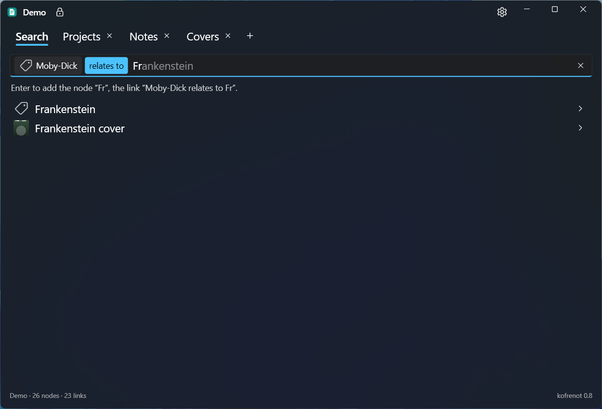
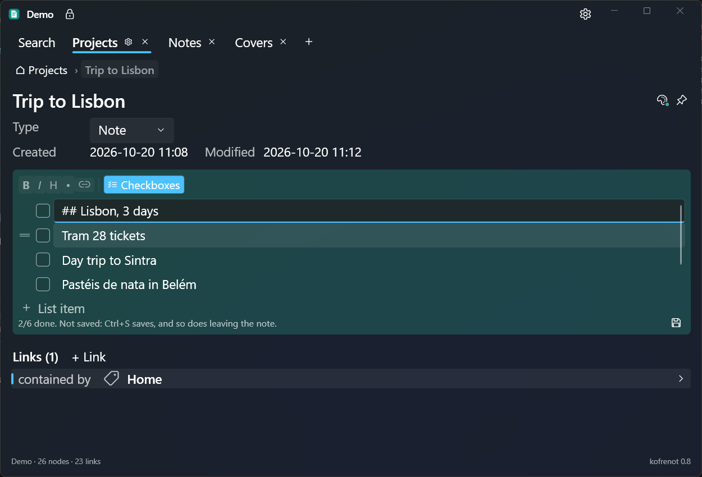
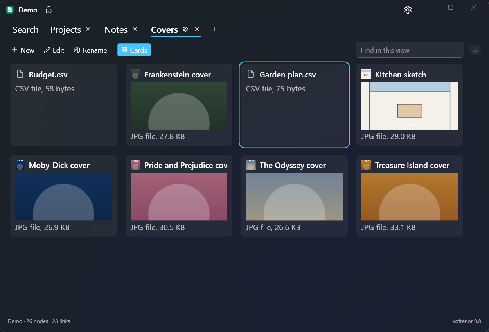
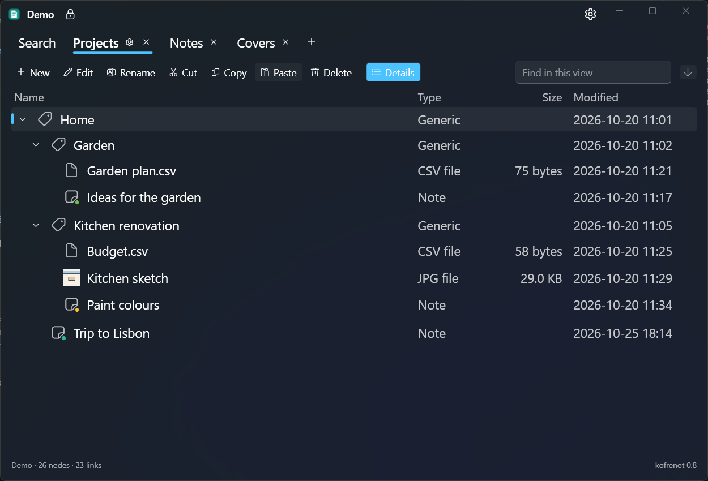

# kofrenot

A private knowledge system for Windows, read on Android too: notes, files and the links between them, encrypted, usable offline, and synced and shared through your own server.



> **kofrenot + Kofre server.** kofrenot is the app; [**kofreserver**](https://github.com/dyze/kofreserver) is its companion server, to run yourself or to get an account on. It syncs your vaults across your devices and shares them with others. It only stores encrypted files: it cannot read them.
>
> ```
> kofrenot (laptop) ─┐                              ┌─ kofrenot (desktop)
>                    ├─► Kofre server (yours) ◄──────┤
> kofrenot (work PC) ┘   encrypted files only        └─ kofrenot (a friend: shared vault)
> ```

## Features

- **One box to find and add**: type `Dune`, or `Dune relates to Frank Herbert`, and the nodes and the link are added. Your own link types too.
- **Notes** in Markdown, with **task lists** and **colours**, as in Google Keep.
- **Datasets**: files of any kind and size, with thumbnails and a viewer for images and texts.
- **Your node types**: a *Person* with a birth date and a website, a *Book* with its genre; a node can have several, and fields of its own. Values are searched offline.
- **Views**: trees and lists over your nodes, in tabs, shown as rows or as **cards**.
- **Encrypted**: everything in a vault, names included, opened by your pass phrase or your recovery key.
- **Offline first**: browse, search and add without a network.
- **Sync and share** through a Kofre server, as a reader or a writer.
- **Versioned**: nothing is overwritten; edits made on two devices are shown, never lost.

### Windows and Android
Both apps share the same vaults and the same core; each shows its own set of features. ✔ supported, — not yet ([ROADMAP](ROADMAP.md)), *never* not planned ([why](docs/ANDROID-CONCEPT.md#not-supported)); a note says how it differs.

| Feature | Windows | Android |
| --- | --- | --- |
| **Vaults** | | |
| Server vaults: add from the server, open, remove from the device | ✔ | ✔ |
| Lock the open vault (padlock) | ✔ | — |
| Privacy screen: the vault covered while hidden | ✔ | out of screenshots and recent apps, unless turned off in Settings > General |
| Server vaults: create, move from a folder, delete | ✔ | — |
| Folder vaults | ✔ | *never* |
| Account: sign up, sign in | ✔ | sign in only |
| Account's pass phrase, recovery key | ✔ | used, not set |
| Sync status, sync now | ✔ | ✔ while the app is shown |
| **Browse** | | |
| Search names, pinned and recent nodes | ✔ | ✔ |
| Search field values | ✔ | ✔ |
| Recent: opened here or changed on any device (last 7 days) | ✔ empty input box | ✔ home |
| Node details, links | ✔ | ✔ |
| Node types and fields shown | ✔ | ✔ (an image's thumbnail, *Open with…*) |
| Views: trees and lists, as tabs | ✔ rows, cards, details | ✔ rows |
| Pin (synced: listed while the input box is empty) | ✔ | ✔ **⋯** on the node's page |
| Keep offline (this device only: content downloaded ahead) | ✔ server vaults | ✔ |
| **Change** | | |
| Add nodes and links (input box, creation screen) | ✔ | ✔ the search box, then a creation screen (a view on Windows; a dataset with **＋**) |
| Labels and proposals while typing (a name or link type becomes a label; the rest of a name proposed after it) | ✔ **Tab** accepts, **Backspace** unlabels | ✔ a tap on the proposal accepts, on the last label or **Backspace** unlabels |
| Rename, colour, pin, delete; move and copy in a tree | ✔ | ✔ rename, colour, pin, delete a node (**⋯**), remove a link (long press); not in a tree |
| Types: add to a node, take out | ✔ | ✔ **⋯** (a view is made on Windows) |
| Your node types: create, change, remove, copy from another vault (Settings > Node types) | ✔ | — |
| Fields: fill, add your own, merge, resolve a conflict | ✔ | ✔ fill (a tap), add your own (text), resolve a conflict; an image set and a merge on Windows |
| History: a node's versions (text, file, view, names, colours, field values) | ✔ listed, restored | ✔ listed, restored |
| Notes: edit | ✔ editor with a Markdown toolbar and a task list editor | ✔ Markdown text, task list editor (no reordering); tap a checkbox |
| Notes: resolve a conflict | ✔ keep one, or merge by hand | ✔ keep one |
| Datasets: add files | ✔ creation screen, drop zone, drop on a tree | ✔ **＋**, with a preview; a photo or video taken |
| Add what another app shares (files as datasets, text as a note) | — (drop files instead) | ✔ the share sheet, with a preview |
| Datasets: new version of a file, resolve a conflict | ✔ | — |
| Datasets: view images and texts | ✔ | — |
| Datasets: open in another app, save as | ✔ **Open**, **Export…**, drag out | ✔ *Open with…*, *Save as…* |
| Views: create, edit | ✔ | — |
| **Share** | | |
| Members, roles, share, leave | ✔ | ✔ share, change a role, leave (Settings > Vault > **Members…**); a member removed on Windows |
| **App** | | |
| Hotkeys, tray, start with Windows, update check | ✔ | *never* (Windows desktop) / — update check |
| Settings | ✔ every tab | Vault, Server, Appearance, Logging and About: members, forget the pass phrase, sign out, theme, logging |
| Theme: light, dark, or as the system (Settings > Appearance) | ✔ | ✔ |
| Exchanges with the server, per day (Settings > Logging) | ✔ | ✔ |

How to use each: [Using kofrenot](#using-kofrenot) (Windows), [On Android](#on-android).

| A note with its task list | Cards | A tree |
| --- | --- | --- |
|  |  |  |

## Install

Download `kofrenot-windows-setup-<version>.exe` from the [releases](https://github.com/dyze/kofrenot/releases) and run it: it installs for your user only, no administrator rights, and needs no .NET runtime. Run a newer setup to upgrade; uninstall from *Settings > Apps* (your data stays).

**Portable**: unzip `kofrenot-windows-portable-<version>.zip` anywhere (a USB stick) and run `kofrenot\kofrenot.exe`: its data stays in the `data` folder beside it.

kofrenot runs in the notification area. **Ctrl+Alt+K** shows it from any program; closing the window hides it.

**Start with Windows** (on by default in the setup, then in Settings > General): when you sign in, kofrenot starts in the notification area, and opens your vault (asking for its pass phrase if not remembered) only when you first show it. The box is ticked only when Windows starts *this* copy; if it starts another one (the installed copy, while you run a build), Settings shows its path, and ticking the box switches to this copy.

## Vaults

A vault holds your nodes, notes and files, encrypted. There are two kinds:

| | **Server vault** (recommended) | Folder vault |
| --- | --- | --- |
| Where | On a [Kofre server](https://github.com/dyze/kofreserver), and on each of your devices | A folder you choose |
| Sync | Built in: every 30 seconds, and soon after a change | Your own sync tool (OneDrive, Syncthing...), or none |
| Sharing | With other accounts on the server, as readers or writers | No |
| Content | Downloaded when first needed: a device keeps only what it uses | All of it, on every device |
| Backup | On the server, by its admin; your devices keep a copy | Yours to make |
| Pass phrase | One for all your server vaults, the account's | One per vault |

- **Add one** in Settings > Vault: *New vault on the server* (sign in first, in Settings > Server), *Vault from the server…*, or a folder (an empty one becomes a new vault). A folder vault can be moved to the server later (*Move to server…*).
- **Recovery key**: shown once when the vault (or the account's pass phrase) is created. Keep it with the pass phrase: **if both are lost, the vault cannot be read**.
- **Several vaults**: one is open at a time, switched in the title bar (or **Ctrl+1** to **Ctrl+9**); each can have its own hotkey. The **padlock** (**Ctrl+L**) locks the open one until its pass phrase is typed again.
- **Privacy screen** (on by default, Settings > General): when the window is hidden or minimized, the open vault is covered, also in the taskbar preview; shown again, it opens on a plain screen until you click **Show** (or press Enter), so nothing shows by mistake while sharing your screen. Unlike the padlock, no pass phrase is asked.
- **Share** a server vault: Settings > Vault > *Members* > *Share...*, with the other person's email, once you both read the same key **fingerprint** (by phone or in person). Removing a member changes the vault's key.
- **Sync status** is in the title bar: a green dot when synced, amber offline, red when you must sign in. A click syncs now.

## On Android

kofrenot for Android **reads** your server vaults, also offline, and **changes their nodes**: notes, files, names, colours, pins, deletes. What defines a vault (your node and link types, its name, its keys) is changed in kofrenot on Windows ([why](docs/ANDROID-CONCEPT.md#what-the-phone-changes)).

- **Install**: download `kofrenot-android-<version>.apk` from the [releases](https://github.com/dyze/kofrenot/releases) and open it (Android 8.0 or later; allow installing from your browser or file app when asked).
- **Sign in** with your server account, then **Add from the server**: your vaults and those shared with you, which show your role (reader or writer) in the list; a vault shared with you to read says so in a banner. The account's pass phrase opens them; tick *Remember it on this phone* to keep it in the phone's Keystore.
- **Read**: search names, pinned nodes, recent nodes (opened on the phone or changed on any device), a node's details and links (back goes through them), notes with their task lists, views as tabs, a node's **History** (its versions; **Restore** makes one the current one again, after a confirmation). A dataset shows its file's name and size: *Open with…* hands it to another app, *Save as…* saves it where you choose. A copy opened with another app is deleted from kofrenot at its next start.
- **Add files**: **＋** picks one or several files on the phone; a preview lists them (their number and total size, the names already taken), then **Add** makes each a dataset named after its file. One file added opens; several show among the recent nodes.
- **Take a photo** or **Record a video** (under **＋**): the phone's camera app takes it, then the same preview names it after when it was taken (*Photo 2026-10-28 20.30*) and **Add** makes it a dataset. kofrenot asks it to write into kofrenot's own files, not the gallery, and deletes its copy once added or cancelled; some camera apps still keep one of their own in the gallery.
- **Share to kofrenot** from another app (its *Share* button): files become datasets, text or a link becomes a new note named after its first line. A preview names the open vault and lists what will be added; nothing is before **Add**. When no vault is open yet, it waits until you open one.
- **Add nodes and links**: type in the search box as in the input box on Windows: `Dune`, `Dune relates to Frank Herbert`, `Kitchen contains Knives`. The line under it says what it adds; a tap shows the creation screen: the link's type, each new node's type (a note with its text), then **Add** adds them and opens the node. A view is made on Windows, a dataset with **＋**. As on Windows, a node or link type recognized becomes a label, and the rest of a name is proposed in grey right after the text: a tap on it accepts it; a tap on the last label (or **Backspace** with no text after it) turns it back into text.
- **Change a node**: **⋯** on its page renames it, gives it a colour, pins or unpins it, or deletes it with its links (asked first, naming what goes). A long press on a link removes it (asked first); the nodes stay. Each change reaches your other devices at the next sync.
- **Fields and types**: a tap on a field fills it: a text typed (empty clears it), a checkbox ticked, an option chosen; an image is set on Windows. **⋯** adds a field of its own (a text), adds a type or takes one out (asked first; the values of its fields stay, as the node's own). A name, colour or value set on two devices before they synced shows each, to keep one.
- **Settings** (gear) groups what the phone has under the topics of the Windows tabs: **Vault** (the open vault, *Members…*, forget its remembered pass phrase), **Server** (the account, *Sign out*), **Appearance** (light, dark, or *Follow Android*, the default), **Logging** (debug details, exchanges with the server) and **About**.
- **Members**: Settings > Vault > **Members…** lists the open vault's members and their roles. Its owner shares it with another account of the server (by its email, after comparing its fingerprint), as a writer or a reader, and a tap on a member makes them a reader or a writer; removing one is done on Windows, as it changes the vault's key. A member leaves a vault shared with them.
- **Edit notes**: tap a checkbox to check its item, or **Edit** to change the note, then **Save**. A note whose lines are all items opens as its list, as on Windows: a checkbox and a text per item, **Enter** adds the next, **✕** removes one, checked items below the others; **Checkboxes** turns a text into items, **Text** turns them back into lines. Other notes are edited as Markdown text (`# heading`, `- item`); **Cancel** keeps it as it was, and leaving the note with changes not saved asks before discarding them. A note edited on two devices before they synced shows both versions: **Keep this version** keeps one.
- **Offline**: every name and link is on the phone; a note's text once it has been shown, and the content of the nodes you **Keep offline** (on the node's page) at once. What you save offline waits on the phone (*· 2 to upload*) and is uploaded at the next sync. The phone syncs when the app opens or comes back, then every 30 seconds while it is shown; the dot says how it stands, a tap syncs now.
- **Private**: the app's screens stay out of the recent apps list and of screenshots. To take a screenshot, untick Settings > General > *Keep kofrenot out of screenshots*; it takes effect at once.
- A vault that needs an upgrade, or an account without its pass phrase yet, is opened once in kofrenot on Windows first.

## Using kofrenot

### Input box
Type in the box at the top of the main window; the line under it says what Enter adds.

| You type | Enter adds |
| --- | --- |
| `Dune` | the node *Dune* |
| `Dune relates to Frank Herbert` | a link between them, and the nodes not there yet |
| `Kitchen contains Knives` | a link from *Kitchen* to *Knives*, read *Knives contained by Kitchen* from the other side |
| `Dune is a novel` | a link from *Dune* to *novel* |

- Matching nodes are listed as you type; **Tab** accepts the rest of a name proposed in grey.
- **Enter** shows the creation screen first: the type of each new node (generic, note, dataset or view), a note's text, a dataset's file.
- With the box empty, your **pinned** nodes are listed, then your **recent** ones: the 10 newest you opened on this computer or that changed on any device in the last 7 days, each node once, with its latest activity (*changed 5 min ago*, *opened yesterday*): a change made on your phone is at hand here. Pins are synced; the nodes opened are this computer's.
- **Keep offline** (the arrow beside the pin, in a server vault's node details): its content (a note's text, a dataset's file) is downloaded ahead and kept on this computer, so it opens offline. Each device chooses its own: nothing is written to the vault. The tooltip says *kept offline* once it is here.

### Node details
**Enter** or a double-click on a node opens its details: its name, types, colour, pin, fields and links. **F2** renames it; **+ Link** (**Ctrl+K**) links it to another; a link opens the node at its other end. **Esc** goes back.

**History** (the clock beside the pin) lists its versions, newest first: its text, file or view definition, its names, colours and field values, each with when and what it held (a note's text is not shown). **Restore** makes one the current version again, after a confirmation: it is written as a new version, so the others stay in the history; restoring one of a conflict resolves it. A note's text or a dataset's file restored in a server vault is downloaded first. Its types and links have no versions, and a node deleted is not restored.

### Node types and fields
A node has one or several **types**, each with its **fields**: *Frank Herbert* can be a *Person* (Born, Website) and an *Author* (Genre). **Add type…** in its details adds one, **×** takes one out (asked first). A note, a dataset and a view are built-in types: a node is one of them at most, and adding another hides its content until it gets that type back.

- **Your node types**, in Settings > **Node types**: a name, an icon, a colour, and fields of a kind: text, number, date, address, checkbox, choice (its options) or image (a *Person*'s portrait). A field added shows empty on its nodes; one taken out stays on them, with its value, as their own.
- **Copy from…** (Settings > Node types) copies node types from another of your vaults: tick the ones to copy, each saying what copying does (*Adds it*, *Updates it*, *Already the same here*, or refused when a type here has its name). Only the types are copied, not the values of their nodes; copied again later, a type is updated, not added twice. The other vault is read as it is on this computer (a server vault: as last synced), never changed.
- **Fill a field** in the details: type its value (**Enter** or leaving the box writes it, **Esc** puts it back, empty clears it), tick a checkbox, or choose an option. A box changed has the accent's border; a value changed is saved when you leave the details, as a note is (one that does not fit, say *soon* for a date, asks to be discarded or kept editing). Dates and numbers are written the same way on every device (`2026-10-27`, `1234.5`).
- **An image field** shows its thumbnail: a click shows the image, **Choose…** sets another (PNG, JPEG, GIF, BMP, TIFF or WebP, up to 64 MB), **×** removes it (asked first). It is stored encrypted as a dataset's file is, downloaded when shown in a server vault; its thumbnail comes with the sync.
- **Add field…** gives a node a field of its own, with its first value; cleared, it goes. A node of several types, or of a type and fields of its own, shows a tab per type, then *Its own*, so it fits without scrolling: a note's tab its text, a dataset's its file, a view's what it shows, the others their fields; links stay under them. The tab with content opens first; the tab chosen stays from node to node, a dot marks one with a value in conflict. Two fields of one name show where they come from (*Born (Person)*, *Born (own)*); the merge button keeps one value.
- A value set on two devices before they synced shows both, to keep one.
- The input box also finds a node by its values: *Frank Herbert — Birthplace: Tacoma*, after the nodes found by name.

### Notes
A note is Markdown text, saved as a new version each time (**Ctrl+S**, or by leaving it). **Checkboxes** on its toolbar turns its lines into a task list.

### Datasets
A dataset holds one file: drop it on the creation screen or on the dataset. Texts and images are shown in kofrenot (decrypted in memory only), others are exported (**Export…**, or drag the file out). **Open** (Ctrl+O, or a double-click on a file that is not an image) opens the file with the app Windows associates with it: a decrypted copy, deleted at kofrenot's next start. Each import is a new version.

**Drop files** (beside the tabs) secures files quickly: drop one or several there, and each becomes a dataset named after its file. A preview first lists them, with their number and total size, the names already taken (*homonym*) and what is skipped (folders); nothing is added before **Add**.

### Views
A view shows your vault another way, in a tab: **a tree** from a node, following a link type (*contains* by default), or **a list** of every node of a type. **+** in the tab bar opens or creates one.

- In a tree: **Ctrl+C**, **Ctrl+X**, **Ctrl+V** and **Del** copy, move and delete, or drag a node onto another. A copy has its original's types, colour and field values, images included. Drop a file on a node to add it under it (the creation screen); several files are previewed first, as with **Drop files**, then added under it.
- **Cards** on a list's bar shows its nodes as cards, with a preview. **Details** shows type, size and last change in columns.
- **Ctrl+F** finds a node in the view.

Every shortcut is listed in Settings > **Key bindings**.

## Settings

Gear button in the title bar, or tray menu > Settings. Changes are saved at once; *Find a setting* (**Ctrl+F**) searches every tab.

| Tab          | Description                                                                           |
| ------------ | ------------------------------------------------------------------------------------- |
| General      | The hotkey that shows kofrenot; where the main window appears; start with Windows; privacy screen |
| Key bindings | Every shortcut                                                                        |
| Vault        | Your vaults: add, remove, order, rename, hotkey, pass phrase, members                 |
| Server       | Your account on a Kofre server: sign up, sign in, password, the account's pass phrase |
| Node types   | Your node types: name, icon, colour and fields                                        |
| Link types   | The link types and their aliases; your own link types                                 |
| Appearance   | Light, dark, or as Windows                                                            |
| Logging      | Debug logging, the log window; exchanges with the server per day (30 days), to copy   |
| About        | Version, update check, changelog, kofrenot's files                                    |

## Your data

- **Where**: your vaults are in the folders you chose or on your server. kofrenot's own files (settings, remembered pass phrases protected by Windows, a cache, logs) are in `%LOCALAPPDATA%\kofrenot`, listed in Settings > About. On Android, in the app's private storage, its remembered pass phrases protected by the Keystore.
- **Private**: kofrenot logs what you do (*Node added*) and errors, never names, file names, content or pass phrases. Its **exchanges with the server** (requests, failures and bytes, per day and kind, for 30 days) are counted on each device only, in Settings > Logging, to analyse a slow sync: numbers only, nothing sent. Its only network use, besides your Kofre server, is a daily check for a newer release, which can be switched off.

**Backup**:

| What | Back up | Restore |
| --- | --- | --- |
| Server vault | On the server ([backup](https://github.com/dyze/kofreserver#backup-and-restore)) | Sign in, then *Vault from the server…* |
| Folder vault | Its folder | Settings > Vault > *Add...* the folder |
| Pass phrases, recovery keys | In a password manager, or on paper | Needed to open any restored vault |

## Development

| Doc | Content |
| --- | --- |
| [docs/GOAL.md](docs/GOAL.md) | Goal, principles, non-goals, open questions |
| [ROADMAP.md](ROADMAP.md) | Planned versions |
| [CHANGELOG.md](CHANGELOG.md) | What each version changed |
| [docs/ARCHITECTURE.md](docs/ARCHITECTURE.md) | Projects, stack, storage, sync, encryption |

**Build** (the .NET 10 SDK): `build\windows.cmd` on Windows, `build/build.sh` on Linux or macOS (build and tests only: the app runs on Windows). Both build `kofrenot.sln` in Release and run the tests; output goes to `artifacts/`. The build fails below **95 %** line coverage of `Core`; `build\windows.cmd open` opens the coverage report. The version is set in `Directory.Build.props` only.

**Android**: `build\android.cmd` makes `artifacts\android\kofrenot-android-<version>.apk` (needs the .NET Android workload, `dotnet workload install android`, the Android SDK and a JDK). It is signed with the release keystore named by `KOFRENOT_KEYSTORE` (alias `kofrenot`, password in `KOFRENOT_KEYSTORE_PASS`), else with Android's debug key, to try it, as `kofrenot-android-<version>-debug.apk`. The app is not in `kofrenot.sln`, so `build\windows.cmd` does not need the workload. On an emulator, `adb reverse tcp:5080 tcp:5080` lets it sign in to a Kofre server on this PC at `http://localhost:5080/`: plain HTTP is accepted only to the phone itself.

**Release signing** (Android): every update of the app must be signed with the same key, or phones cannot install it over the previous one.

1. Create the keystore once, outside the repository, with the JDK's `keytool` (it asks a password, then the certificate's name and organisation):
```
keytool -genkeypair -v -keystore D:\keys\kofrenot-release.keystore -alias kofrenot -keyalg RSA -keysize 4096 -validity 10000
```
1. Back up the keystore and its password (a password manager, a second copy): lost, the app cannot be updated, only uninstalled and installed again. Never add it to the repository.
2. Build from the repository folder, the password typed rather than written in a file or the command history (PowerShell):
   ```
   $env:KOFRENOT_KEYSTORE = "D:\keys\kofrenot-release.keystore"
   $env:KOFRENOT_KEYSTORE_PASS = Read-Host "Keystore password"
   .\build\android.cmd
   ```
3. Check: `apksigner verify --print-certs <apk>` (Android SDK, `build-tools`) names your certificate, not *Android Debug*. A release APK does not install over one signed with the debug key: uninstall that one first.

**Install on a phone** with `adb` (Android SDK, `platform-tools`): turn on the phone's *Developer options* (tap *Build number* 7 times in *About phone*), then *USB debugging*, plug it in and accept the prompt. `adb devices` lists it as `device`, then:
```
adb install -r artifacts\android\kofrenot-android-<version>.apk
```
`-r` updates the installed app and keeps its data. `INSTALL_FAILED_UPDATE_INCOMPATIBLE` means the installed copy has another signing key: `adb uninstall eu.dlabs.kofrenot` first, which deletes the app's data on the phone (let it sync first: what is not uploaded yet is lost). Over Wi-Fi (Android 11+): *Wireless debugging*, `adb pair <ip>:<port>` with the code shown, `adb connect <ip>:<port>`, then the same `adb install`.

**Installer**: `build\installer.cmd` makes `artifacts\installer\kofrenot-windows-setup-<version>.exe` and `kofrenot-windows-portable-<version>.zip` (needs [Inno Setup](https://jrsoftware.org/isinfo.php) 6.3+).

**Another set of data**: `kofrenot.exe --data D:\kofre-test` keeps settings, vaults list, remembered pass phrases and server account in that folder: to test, or to try sharing with a second account. One kofrenot runs at a time: quit the other first (tray icon > *Quit*).

**Demo data** (for screenshots): `dotnet run --project samples\DemoVault` writes a vault of made-up books, notes, task lists, pictures and views to `artifacts\demo`; then, from the repository folder, `kofrenot.exe --data artifacts\demo\data` opens it (pass phrase `demo`, remembered on this computer; quit a running kofrenot first).

| Folder              | Purpose                                                                                  |
| ------------------- | ---------------------------------------------------------------------------------------- |
| `artifacts/`        | Build output (git-ignored)                                                               |
| `build/`            | Build scripts (`windows.cmd`, `build.sh`), installer and Android scripts, icon generator |
| `.config/`          | Local dotnet tools (ReportGenerator)                                                     |
| `docs/`             | Documentation and its images                                                             |
| `lib/`, `packages/` | Third-party binaries and local NuGet packages, if any                                    |
| `samples/`          | `DemoVault`: the demo data generator                                                     |
| `src/`              | `kofrenot.App` (WPF), `kofrenot.Android` (Avalonia) and `kofrenot.Core`                  |
| `tests/`            | Unit tests for `Core`                                                                    |

## License

[MIT](LICENSE)
